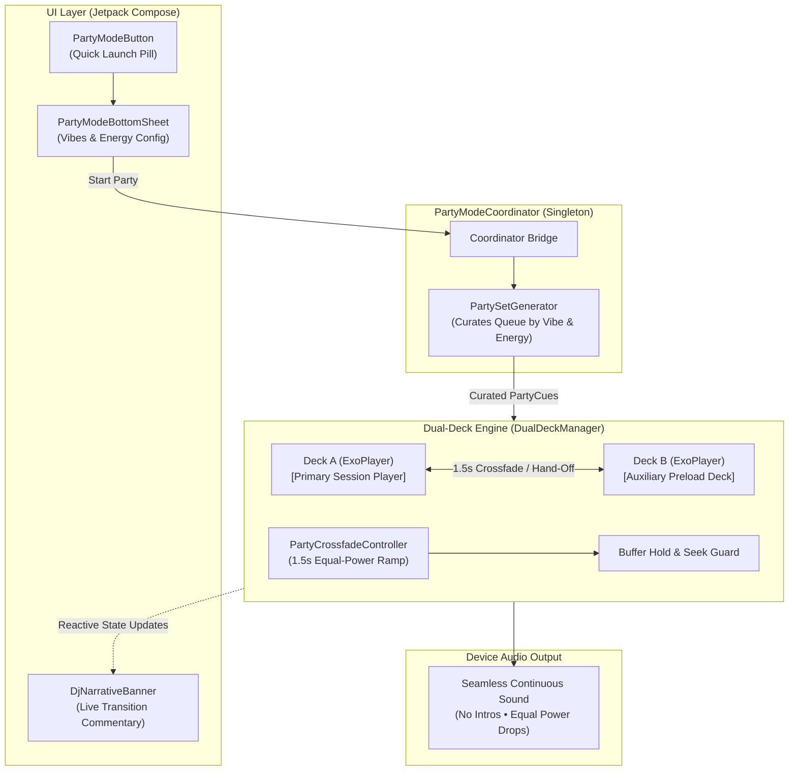

# 🎧 Technical Implementation & Integration Plan: Hook-Drop & Dual-Deck Party Mix Mode

**Target Project:** Bitlify (Android Music Player / BitChord engine)  
**Author / Architect:** Google Antigravity & Lead Engineer  
**Recipient:** Lead Android Integration Engineer  
**Feature Codename:** `PartyMixMode` (Inspired by NAUX.party)  
**Status:** Pre-built in codebase (`com.music.bitchord.party.*`), ready for UI/Service wiring.

---

## 1. Executive Summary & Objective

The goal of this feature is to solve the **"Aux Cord Problem"** at parties and gatherings. Traditional music apps play slow, awkward 30–50 second song intros and full fadeouts, killing room energy and forcing users to constantly babysit the seek bar.

**Hook-Drop & Dual-Deck Party Mix Mode** turns Bitlify into an automated, seamless DJ:
1. **Zero Intros ("Drop at Hook")**: Every track starts playing directly at its energetic chorus/drop timestamp (`hookStartSec`, e.g., 20–45s in).
2. **Dual-Deck Engine**: A secondary `ExoPlayer` instance silently preloads the incoming track in the background at `volume = 0.0f` and seeks ahead to its hook timestamp before it ever plays aloud.
3. **1.5s Equal-Power Crossfade**: When the live track reaches its mix-out point (`hookEndSec`), both decks crossfade using a mathematical equal-power sine/cosine curve that prevents the "mid-fade volume dip" common in linear crossfades.
4. **Buffer Hold Safety**: If the next track is still buffering due to network latency, the live track keeps playing smoothly — **it never cuts into silence**.
5. **Absolute Rule #1 (Zero Breakage Guarantee)**: When Party Mode is switched OFF, the secondary deck shuts down, and default single-player audio playback operates 100% untouched.

---

## 2. Architecture & Data Flow



---

## 3. Pre-Built Code Inventory (In Repository)

All core files have already been implemented and tested in the repository under `src/main/kotlin/com/music/bitchord/party/`:

| Component | Path | Responsibility |
| :--- | :--- | :--- |
| **Data Model** | `model/PartyCue.kt` | Wraps tracks with `hookStartSec`, `hookEndSec`, `energy` (1.0–10.0), and fallback heuristics (25% of duration). |
| **Vibe Config** | `model/PartyVibe.kt` | Enums: `SpecialtyVibe` (DHH, Hustle, Legacy, Hardcore, Desi Dance, Punjabi), `TimeOfNight`, `CrowdSize`. |
| **State Snapshot** | `model/PartyState.kt` | Reactive, immutable state model tracking both decks, active status, volumes, and live DJ commentary. |
| **Crossfade Engine** | `playback/PartyCrossfadeController.kt` | Computes sinusoidal equal-power volume curves, manages buffer hold, and protects user seeks. |
| **Dual-Deck Manager** | `playback/DualDeckManager.kt` | Controls two ExoPlayer instances, handles background preloading, track rotation, and audio focus. |
| **Setlist Generator** | `generator/PartySetGenerator.kt` | Filters and ranks tracks based on room vibe and progressive energy curves. |
| **Coordinator Bridge**| `PartyModeCoordinator.kt` | Singleton facade connecting the UI, queue, and ExoPlayer instance. |
| **UI Components** | `ui/PartyModeButton.kt`<br>`ui/PartyModeBottomSheet.kt`<br>`ui/DjNarrativeBanner.kt` | Brutalist dark-mode Compose UI with animated chips, sliders, and live DJ commentary. |

---

## 4. Mathematical Equal-Power Crossfade Formula

Standard linear crossfades cause a perceptible ~3dB drop in perceived loudness in the middle of a transition ($t = 0.5$). Bitlify uses an **equal-power curve** where total acoustic energy remains constant ($V_{\text{in}}^2 + V_{\text{out}}^2 = 1$):

$$\text{Incoming Track (Fade-In):} \quad V_{\text{in}}(t) = \sin\left(\frac{t}{T} \cdot \frac{\pi}{2}\right)$$

$$\text{Outgoing Track (Fade-Out):} \quad V_{\text{out}}(t) = \cos\left(\frac{t}{T} \cdot \frac{\pi}{2}\right)$$

*Where $T = 1.5\text{ seconds}$, evaluated every 16ms (60 FPS).*

---

## 5. Step-by-Step Integration Guide (For the Developer)

### Step 1: Initialize Coordinator in your Audio Service or Dependency Graph
In your `PlaybackService.kt` (or wherever your central `MediaSession` / `ExoPlayer` is managed):

```kotlin
// Inside PlaybackService.kt
val partyCoordinator = PartyModeCoordinator.getInstance(
    context = applicationContext,
    primarySessionPlayer = player // Passes existing ExoPlayer as Deck A
)
```

> **Why this matters:** Passing your existing player as `Deck A` ensures existing media notifications, lockscreen controls, and Bluetooth audio sinks remain active without creating unnecessary audio sessions.

---

### Step 2: Wire the UI Controls into the Player Screen
In your Now Playing screen or Player Pane composable (`PlayerPane.kt` / `GlassNowPlayingScreen.kt`):

```kotlin
@Composable
fun PlayerScreen(
    currentTrack: Song,
    currentQueue: List<MediaItem>,
    modifier: Modifier = Modifier
) {
    val context = LocalContext.current
    val partyCoordinator = remember { PartyModeCoordinator.getInstance(context) }
    val partyState by partyCoordinator.partyState.collectAsState()
    var showPartySheet by remember { mutableStateOf(false) }

    Column(modifier = modifier) {
        
        // 1. Live DJ Commentary Banner (above the seekbar)
        if (partyState.isEnabled) {
            DjNarrativeBanner(
                partyState = partyState,
                modifier = Modifier.padding(horizontal = 16.dp, vertical = 8.dp)
            )
        }

        // 2. Standard Seekbar & Track Info
        // ... (Existing seekbar code)

        // 3. Player Controls Row: Add the Party Launcher Pill
        Row(
            verticalAlignment = Alignment.CenterVertically,
            horizontalArrangement = Arrangement.SpaceBetween
        ) {
            // Existing Prev/Play/Next buttons...

            PartyModeButton(
                partyState = partyState,
                onClick = { showPartySheet = true }
            )
        }
    }

    // 4. Party Configuration Bottom Sheet
    if (showPartySheet) {
        PartyModeBottomSheet(
            partyState = partyState,
            onDismissRequest = { showPartySheet = false },
            onStartParty = { config ->
                // Starts the curated party set from current queue
                partyCoordinator.startPartyMode(
                    catalogItems = currentQueue,
                    config = config
                )
            },
            onStopParty = {
                partyCoordinator.stopPartyMode()
            },
            onSkip = {
                partyCoordinator.skip() // Immediate 1.5s crossfade into next drop
            },
            onTogglePlayFull = {
                partyCoordinator.togglePlayFull() // Bypasses cut point for this track
            }
        )
    }
}
```

---

### Step 3: Mapping App Tracks to `PartyCue`
If a track doesn't have pre-tagged hook timestamps, `PartyCue.kt` includes an automatic fallback heuristic:
- **`hookStartSec`**: Defaults to **25% of total song duration** (where standard radio/streaming tracks enter chorus 1).
- **`hookEndSec`**: Defaults to `hookStartSec + 38 seconds` (a high-energy 38s hook window).
- If your database has custom hook timestamps, pass them in directly:

```kotlin
val cue = PartyCue(
    mediaId = song.id,
    title = song.title,
    artist = song.artist,
    mediaUri = song.streamUrl,
    durationMs = song.durationMs,
    hookStartSec = song.customHookStart ?: (song.durationMs / 4000L),
    hookEndSec = song.customHookEnd ?: (song.hookStartSec + 40L),
    energy = song.energyScore ?: 8.0f,
    specialtyVibe = "underground_dhh"
)
```

---

## 6. Edge Cases & Safety Guards Handled

| Edge Case | How It Is Handled |
| :--- | :--- |
| **Incoming Stream Buffering** | `Buffer Hold Safety`: If Deck B is buffering when Deck A hits the cut point, Deck A continues playing past `hookEndSec` until Deck B reaches `Player.STATE_READY`. **No dead air.** |
| **User Seeks Near Cut Point** | `Seek Guard`: If the user scrubs the seek bar within 3 seconds of `hookEndSec`, the engine automatically activates `Play Full Track` mode so the song doesn't abruptly end. |
| **Manual Skip Button Pressed** | Triggers an immediate 1.5s crossfade into the next song's hook instead of an abrupt hard stop. |
| **User Disables Party Mode** | `stopPartyMode()` immediately halts Deck B, clears its media item, restores Deck A's volume to `1.0f`, and normal player behavior resumes. |
| **Audio Focus** | Deck A retains primary audio focus (`C.AUDIO_CONTENT_TYPE_MUSIC`, `handleAudioFocus = true`). Deck B is auxiliary (`handleAudioFocus = false`) to avoid triggering system focus ducking. |

---

## 7. QA & Verification Checklist

Before releasing the build, verify these test cases:

- [ ] **Baseline Check**: With Party Mode OFF, standard playback, seeking, pausing, and queuing work 100% normally.
- [ ] **Hook Drop**: Turn Party Mode ON. Track starts playing immediately at its hook (~25-30s in), skipping the intro.
- [ ] **Silent Background Preload**: Verify Deck B loads Track 2 silently in logcat without audible audio bleeding while Deck A is playing Track 1.
- [ ] **Crossfade Curve**: At `hookEndSec`, both tracks blend smoothly for 1.5s. No volume dip in the middle.
- [ ] **Simulated Network Lag**: Throttle network connection. Confirm Deck A continues playing without cutting into silence while Deck B buffers.
- [ ] **Party Mode Turn-Off**: Tap "Turn Off Party Mode" during playback. Deck B stops immediately, Deck A plays full track at volume `1.0f`.

---

## 8. Summary for the Integrator

You don't need to write the playback coordinator or crossfade math from scratch — **all 10 Kotlin files are already written and placed in `src/main/kotlin/com/music/bitchord/party/`**.

Your primary task is simply to:
1. Initialize `PartyModeCoordinator` in your player scope.
2. Place `PartyModeButton`, `DjNarrativeBanner`, and `PartyModeBottomSheet` into the player Compose UI.
3. Pass `currentQueue` into `partyCoordinator.startPartyMode(...)`.
